# Web Organization Framework


A **communication-first modular organization kernel** that can begin as shared messaging and grow into protected voice, responsibility, hierarchy, authority, resource, sector, pressure-learning, civic-governance, and federation workflows.

This repository is a Node.js SSR application that starts as a usable discussion, forum, and notification workspace, then lets an organization progressively enable higher‑stakes modules without adopting one fixed operating model. The former party-centric product name is retired; **Party Circle** remains an optional civic policy bundle. Its identity layer can enforce **one natural person = one voice** **without storing raw PII** when that bundle is enabled.

> **Status / intent**
> Practical scaffold for pilots, internal deployments, and research‑grade iteration. Some protocols (OIDC4VP, ActivityPub, federation hardening) are present as scaffolding and will evolve — see `ROADMAP.md`.

---

## Walkthrough: a party decides its own position

The demo deployment is the framework's civic mode — the representative-party model of `principle-docs/RepresentativeParties.md`, played out as Scenario A of `principle-docs/SimulationScenarios.md`. Members of *Rete Civica Nazionale* — a **fictional** Italian civic party — take real Italian policy questions from a message to a decision, under strict Circle enforcement (**one verified person = one voice**). The copy is English; the party's legal order stays Italian and real (`Law 120/2007` and `Law 107/2024` on intramoenia and CUP monitoring, the PNGLA priority classes, judgment `192/2024` on differentiated autonomy, art. 67 of the Constitution on the free mandate). The people and the institution are invented.

Run `npm run screenshots:readme` after `npm install` to refresh the walkthrough. The command starts an isolated strict-Circle deployment on a temporary loopback port, drives the party journeys through the browser, and replaces the images after the assertions pass and the captures match the README links.

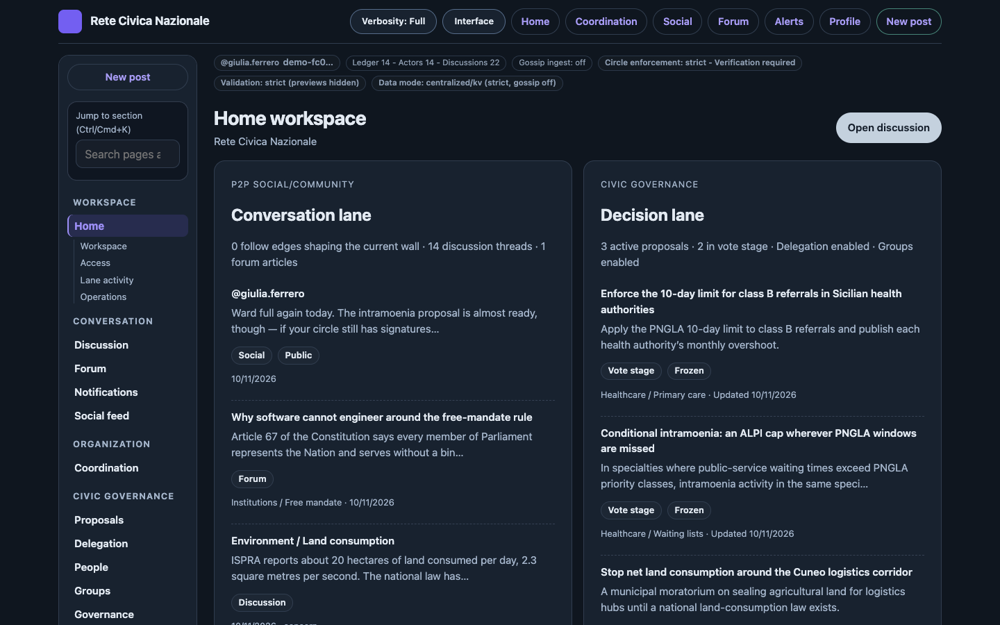

| | |
|:--|:--|
| <br>**1 · Conversation before any vote** — five stance-tagged notes on *Healthcare / Waiting lists*, each by a verified `@handle` with its blinded-hash cue: lived experience, aggregated CUP data, the territory, and a researcher asking whether the number is a median — answered with a method. | <br>**Deliberation that changes a mind** — on differentiated autonomy (a split that is geographic, not left-vs-right), `@tommaso.ricci` concedes a point in public and the thread survives it. |
| <br>**2 · The long-form lane** — the constitutional lawyer argues why software cannot engineer around the free mandate (art. 67); a member asks whether the ethical pact is a party whip by another name, and she answers in the thread. | <br>**3 · A proposal earns its way** — the structured outline (problem / action / impact / risks / plan) tightens `Law 120/2007` instead of inventing a new right. |
| 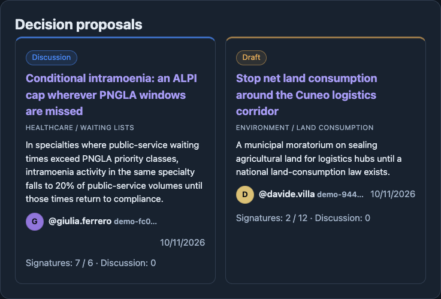<br>**4 · Quorum, not an admin, moves it** — signatures from distinct people carry the proposal into discussion; a single-member land-use draft stays visible under its own higher quorum, so the long tail is not buried. | 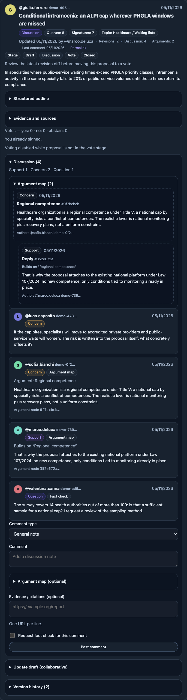<br>**5 · The disagreement has a shape** — a Title V objection as an argument node with the economist's rebuttal under it, the restaurateur's concern, and a fact-check request on a specific claim, read oldest-first. |
| 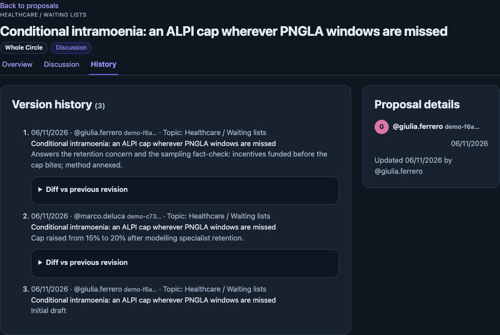<br>**Deliberation changes the text** — draft → the economist's cap revision → the author's answer to the concerns, each revision attributed, noted, and diffable. | 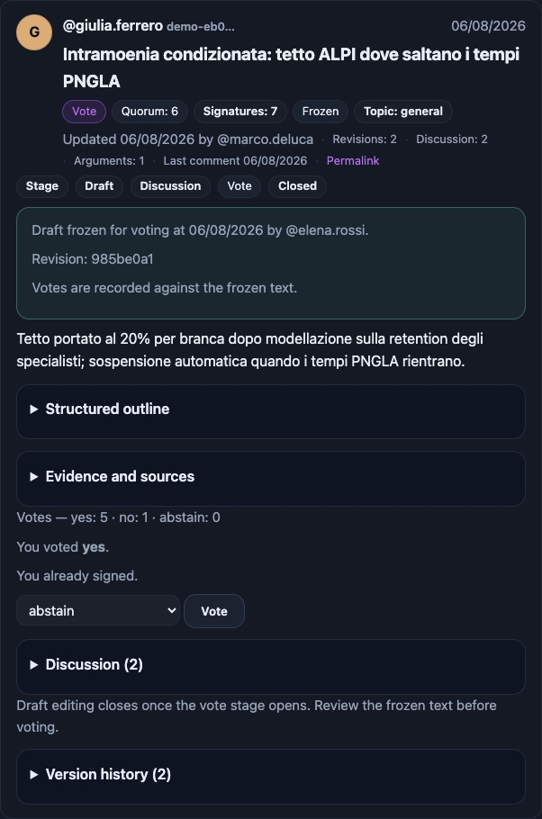<br>**6 · Opening a vote is deliberate** — the party secretary's attributed, timestamped pre-vote freeze; votes are cast against text that can no longer move, and the tally records the `no`. |
| 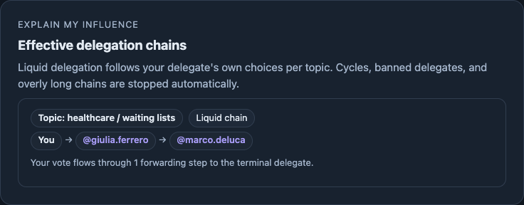<br>**7 · Delegation is liquid and readable** — the "explain my influence" chain `You → @giulia.ferrero → @marco.deluca`, chosen by `@handle`, topic-scoped, revocable, and decay-aware. | 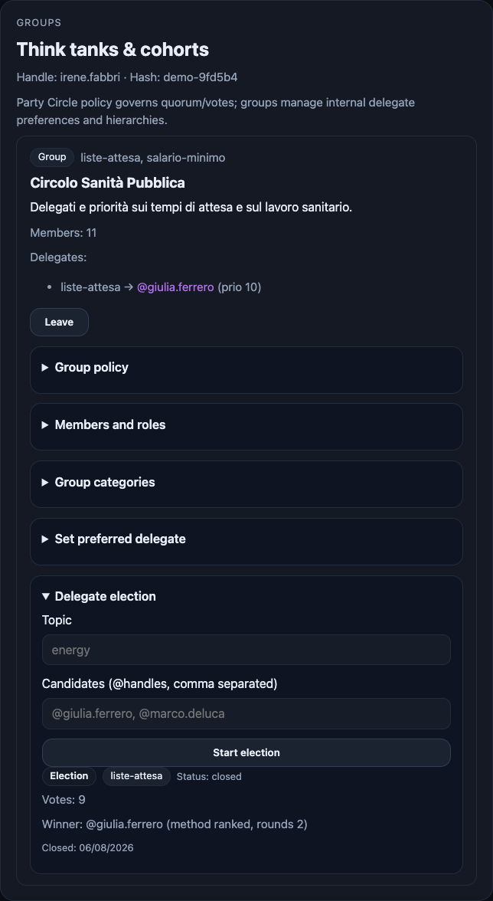<br>**8 · Choosing people, on transfers** — the economist leads first preferences, but the frontline nurse wins in round two: the first-preference leader loses, as ranked transfers exist to allow. |
| 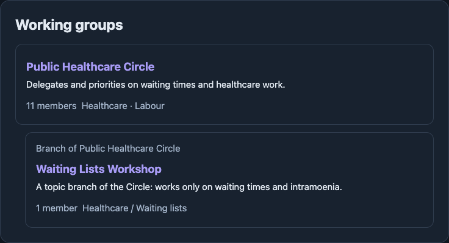<br>**9 · Structure can grow without inheriting power** — the *Waiting Lists Workshop* sits beneath the *Public Healthcare Circle* but keeps its own membership and delegate cachets. The tree describes where work happens; it does not manufacture authority. | 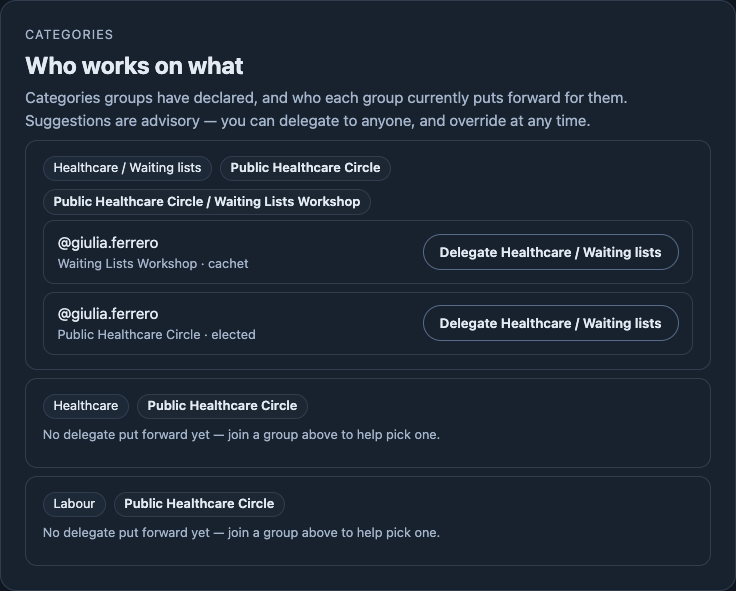<br>**Who works on what** — declared categories become a browsable directory of the groups covering them and the people they put forward. A member can delegate from the directory, then override that advice at any time. |
| 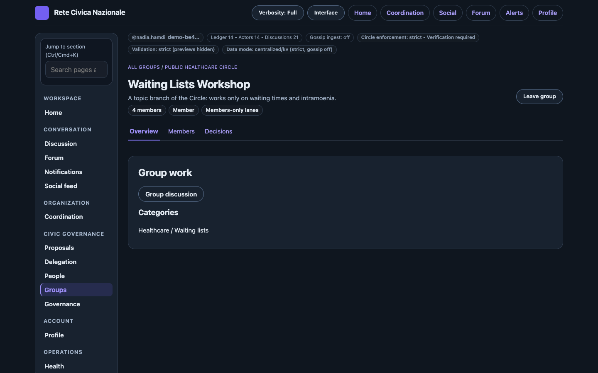<br>**Work in a branch** — the *Waiting Lists Workshop* shows its lineage, category, and members-only discussion lane. | 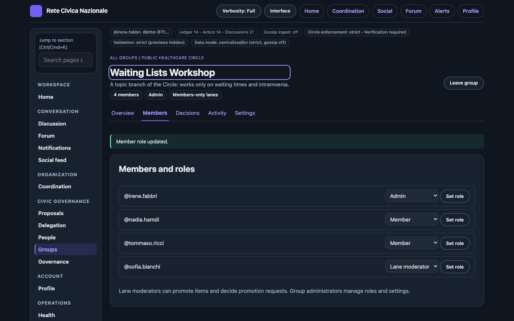<br>**See who can act** — Members lists the branch roster and its roles. The group administrator assigns lane moderation to `@sofia.bianchi`. |
| 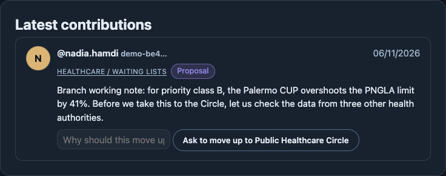<br>**10 · Working notes can stay internal** — optional group lanes are off by default. This members-only branch note stays out of the Circle-wide feed until someone asks to move it up. | 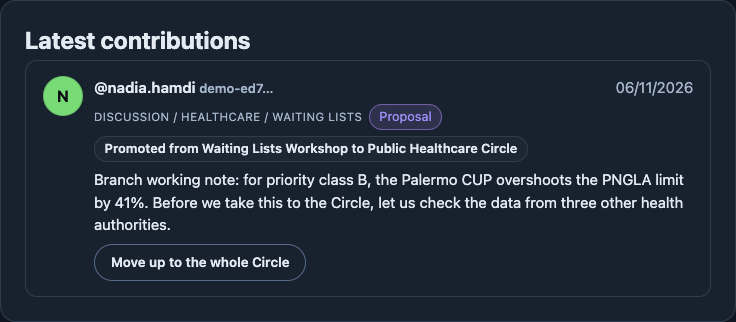<br>**A member asks; a lane moderator decides** — the note moves to the parent circle with a visible provenance stamp. It is a move, not a copy, so the thread keeps its id and its replies travel with it. |
| 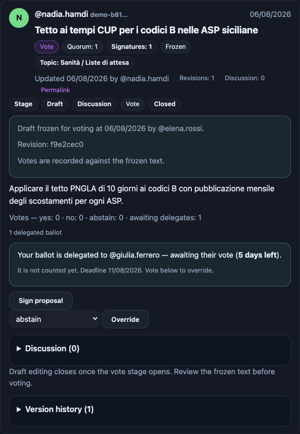<br>**11 · A delegated ballot is not an abstention** — `@davide.villa` delegates the broad `Healthcare` category and it reaches a `Healthcare / Primary care` proposal. While the delegate still has time, the ballot is shown as awaiting and stays outside every tally bucket; he can override it. | 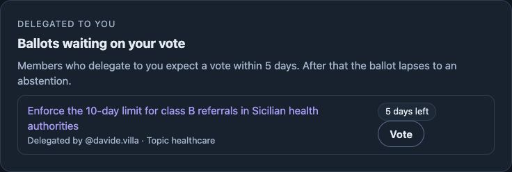<br>**The delegate sees what is riding on them** — `@giulia.ferrero` gets the proposal, who handed it to her, and the five-day countdown. If the window lapses the ballot becomes an abstention; until then it remains pending. |
| 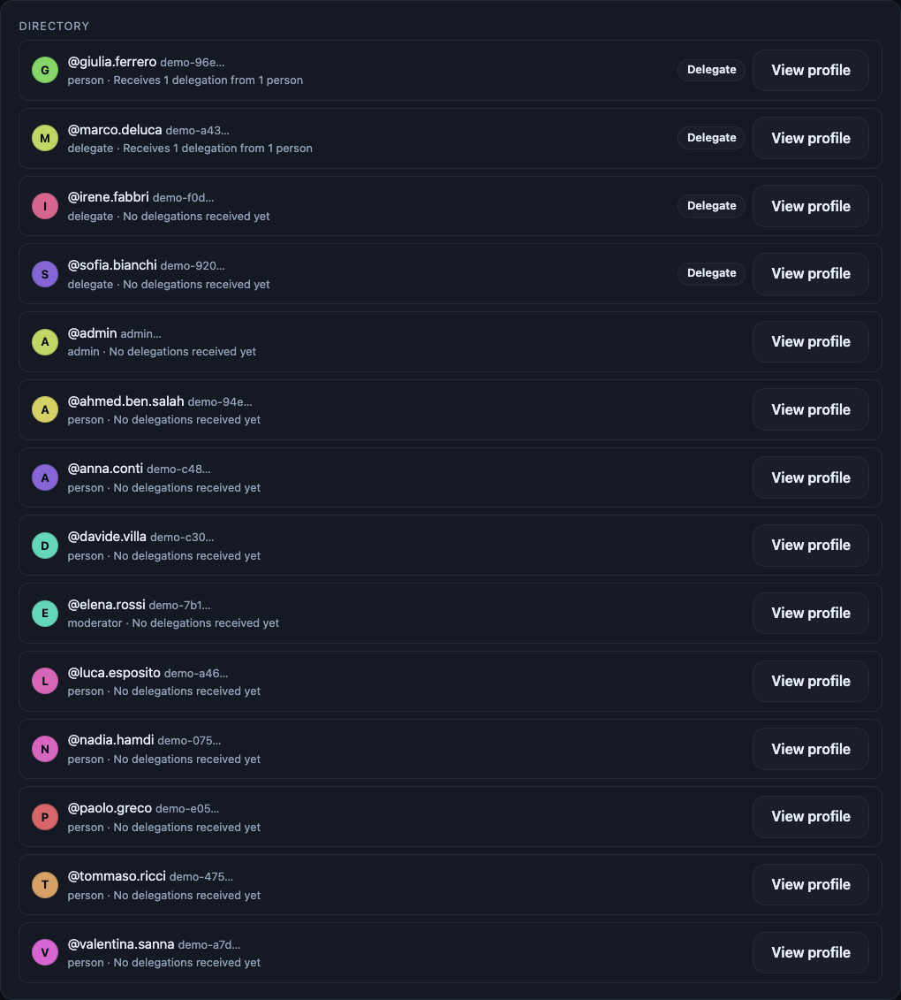<br>**12 · Accountability is soft power** — members browse People by `@handle`, never by pasting a hash; delegates rank first. | 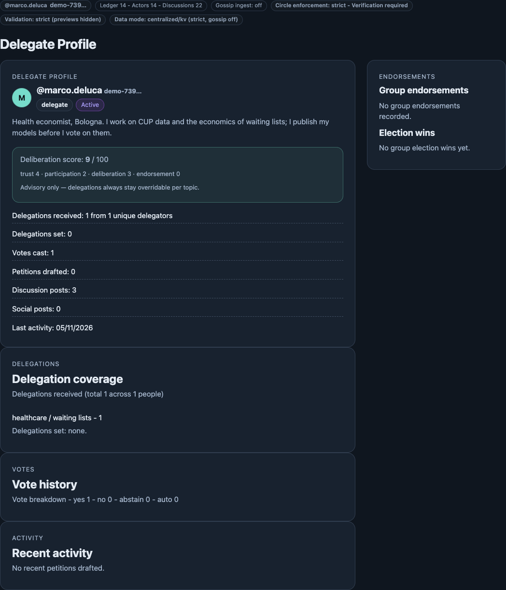<br>**The accountability dashboard** — a provider-local public bio, delegations received and set, vote history, and group endorsements, beside an **advisory** (never binding) deliberation score. |
| 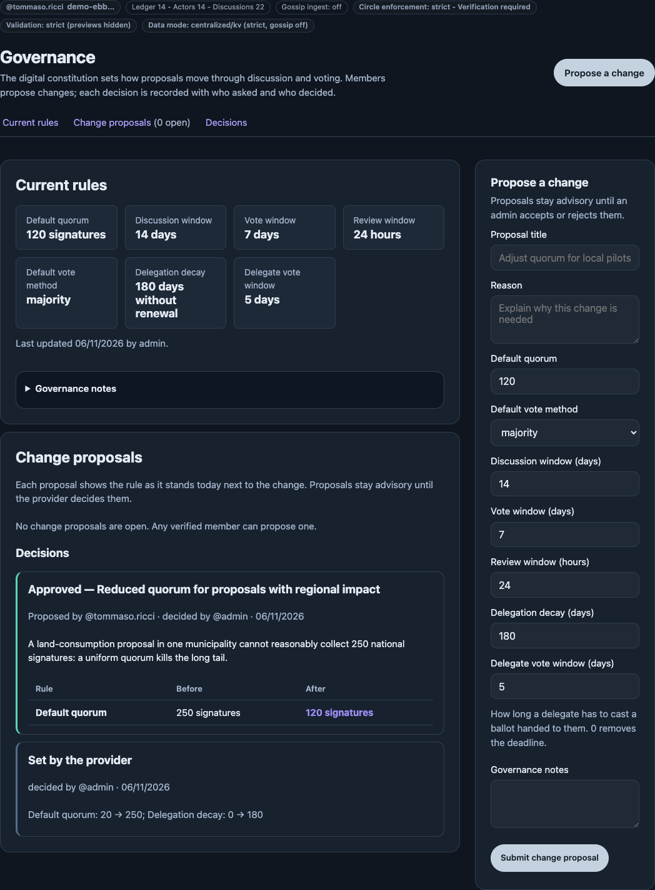<br>**13 · The rules can be changed from below** — a member proposes lowering the default quorum because the uniform one starves the long tail; the decision keeps who proposed it apart from who decided it. The tension stays visible: today the provider decides. | 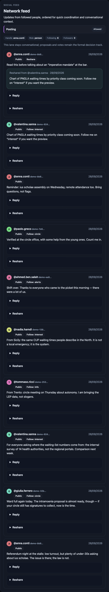<br>**The social lane stays social** — short attributed updates from followed people, typed follows (`circle` / `interest` / `info` / `alerts`), and a reshare with commentary. No quorum, no stance, no tally: it is structurally separate from the decision track. |

Nothing here compels a representative: a member could vote against the platform's own outcome and the record would simply show it. The free mandate (art. 67 of the Constitution) stays intact; the accountability is that no one can quietly rewrite what happened.

The same kernel also runs outside politics. The organization-operations half (`principle-docs/OrganizationPressureManagement.md`) has its own driver, `scripts/user-journeys.js`, which exercises intake, the `/organization` workspace, and the shared proposal/vote/group/delegation flows as a regression check; it is not the product's demo face.

---

## Why this exists

Many organization and civic platforms fail in one of three ways:

1. **They ship “voting” before shipping “conversation.”** People need a place to learn, argue, and revise ideas before any decision has legitimacy.
2. **They bind trust to centralized identity.** That creates pressure to collect personal data, which becomes a liability and a power imbalance.
3. **They impose a complete organization model before earning adoption.** People are asked to replace familiar communication with forms, taxonomies, and dashboards all at once.

This project takes the opposite stance:

- Start with **familiar communication and accountability cues**.
- Promote a message into a structured case only when ownership, protection, authority, resources, mediation, or learning adds value.
- Add **formal decision tools** only when you can defend them socially and operationally.
- Keep identity **privacy‑first** by storing only **blinded hashes** (not names, not documents).

---

## Who it’s for

- Care providers, companies, cooperatives, associations, unions, NGOs, civic committees, and community groups
- Researchers prototyping representation models (liquid delegation, topic‑scoped voting, federation)
- Teams that need a *deployable* baseline today, not a perfect protocol paper

---

## Vocabulary

- **user**: the default actor in general deployments.
- **person**: a Circle label for a **verified natural person** (civic/party mode).

When civic mode is enabled, the *exclusion principle* applies: **org/bot/service accounts cannot hold handles or act**.

The code keeps this distinction explicit so deployments can start lightweight and become stricter later without rewiring the UX. UI copy follows the same rule: “person” labels appear only when Circle enforcement is strict; otherwise the UI uses “user”.

---

## Highlights

- **Messaging‑first kernel**: discussion + forum + notifications work alone, with evidence/citation links supported on discussion notes and forum comments.
- **Organization pressure workspace** opens a case from an attributed discussion post, records an acknowledgement and review date, and keeps the original post and evidence visible. An illustrative workspace shows the planned email, protected voice, and advanced layers.
- **Natural‑person exclusion principle (optional)**: a Circle can require verified natural persons (no org/bot/service accounts holding handles).
- **Blinded uniqueness ledger**: prevent duplicate participation without retaining raw PID/PII.
- **Provider-blind option (scaffold)**: `/admin` policy fields for observe/strict, ring registry gossip, and ringSignature placeholders for votes/transactions; issuer escrow + mixnet transport planned.
- **Privilege-free genesis (optional)**: Circles can bootstrap without preassigned roles beyond provider admins; groups and member votes can evolve governance structures over time.
- **Petitions → votes pipeline**: proposals with evidence summaries + source links, structured outline fields (problem/action/impact/risks/plan), collaborative revisions + version history, revision diffs + pre‑vote freeze, signatures/quorum, deliberation feed with stance tags (support/concern/question) + fact‑check flags + evidence/citation prompts, and argument‑map linking for pro/con trees.
- **Governance defaults**: admin-managed constitution defaults (quorum, discussion/vote windows, vote method) with verified-user change proposals, admin decisions, and public decision history.
- **Module control center**: admin toggles plus a settings map with jump links so module activation and configuration stay in one place (links are defined alongside module metadata).
- **Module lanes**: optional modules are grouped by lane (`Organization operations`, `P2P social/community`, `Civic governance`, `Federation/resilience`) so deployments can compose only the operating model they need.
- **Operational home workspace**: `/` stays useful for guests and signed-in members, showing access gates, recent lane activity, and operator cues instead of acting like a brochure or a forced redirect.
- **Topic gardener review**: admin confirms rename/merge/split plus anchor promotion/archival suggestions with history diff previews.
- **Audit trails**: append‑only transactions for discussions, petitions (signatures/comments), social, group actions, and outbound deliveries with exportable summaries.
- **Identity throttles**: per‑handle/session rate limiting (IP fallback) to curb spam without CAPTCHA.
- **Liquid representation**: topic‑scoped delegation with revocable overrides. A delegation on a category also covers its subcategories, narrowest match first — and proposals carry the category their author chose, so those delegations actually reach them.
- **Delegated ballots with a deadline**: handing your vote to your delegate records a real ballot, not an abstention. It resolves through the delegate's own vote (transitively), stays uncounted while it waits, lapses to abstain if the delegate misses the window (`delegateVoteWindowDays`, default 5), and you can override it yourself at any time.
- **Branch groups**: a group can be a subgroup of another — a party with a think tank, a working wing, or an alternative line. Nesting is structural, not authority: a branch keeps its own membership and cachets.
- **Group workspaces**. Open a group from the directory to see its lineage, readable discussion and proposal lanes, member roles, and delegate decisions. Eligible managers get a separate Settings view.
- **Group categories + directory**: groups declare the categories they discuss, and `/groups` answers "who works on what" — each category, the groups covering it, and who they put forward — with one-click delegation.
- **Optional group lanes**: a group can switch on its own internal discussion and proposal lanes (off by default, members-only or public to read). Internal items stay out of the Circle feed until promoted.
- **Promote to the upper level**: a group discussion or proposal can be moved to the parent group, or to the whole Circle. It is a move, not a copy — comments, signatures and votes travel with it. Ordinary members can *request* a promotion; group admins and lane moderators decide, and a decline carries a reason.
- **Group roles**: `member`, `lane moderator` (can act on lane items but not on what defines the group), and `admin`.
- **Branch election roll-up (optional)**: a parent group can opt in to adopting a branch's closed election for a category it has not voted on itself, always labelled with the branch it came from.
- **Delegate profiles**: view delegation counts, vote history, and group endorsements (optional `publicBio` profile field).
- **Federation scaffolding + redundancy knobs**: gossip endpoints, signed envelopes, and ActivityPub inbox ingestion (preview‑gated) for auditability.
- **Libp2p readiness (optional)**: dependency included to evaluate P2P transport and future Circle key continuity not tied to the first provider.
- **Peer ledger audits**: peer health tracks last ledger hash snapshots (match/mismatch) in `/admin` and `/health`.
- **Peer capability hints**: ledger gossip includes module/data-mode snapshots so `/admin` can show peer capabilities and gossip skips disabled endpoints.
- **Gossip efficiency**: peer capability hints are fingerprinted and provider-blind announcements are cached by `updatedAt` to reduce repeated gossip normalization work.
- **Gossip pull skip-cache**: optional endpoint probes (`/votes/ledger`, `/transactions/ledger`) are cached after module-disabled/optional misses so repeated pulls avoid redundant failures; cache status is visible in `/admin` and `/health`.
- **Gossip push skip-cache**: outbound endpoint posts (`/circle/gossip`, `/votes/gossip`, `/transactions/gossip`) are cached after module-disabled/gossip-disabled responses so repeated pushes avoid redundant retries; cache status is visible in `/admin` and `/health`.
- **Sticky composer UX**: social composer auto-collapses on downward scroll to keep the wall readable while preserving manual expand controls.
- **Practical interface controls**: top bar includes a persistent Interface panel — appearance (accent hue + density), per-page section show/hide, large text, reduced motion, compact nav, composer auto-collapse preference, and partial-navigation toggle — with inline save-to-session-defaults, plus a side-nav jump filter with `Ctrl/Cmd+K` and `/` shortcuts. The theme is built on an HSL semantic-token system so one accent knob re-tints the whole UI.
- **Storage‑agnostic**: pluggable persistence adapters and `DATA_MODE` profiles.
- **Profile attributes**: schema‑driven provider‑local fields with a per‑session editor, schema versioning, inline validation, and stale‑schema warnings; never gossiped.
- **Extension lifecycle**: discover provider-local extensions, record installed versions, install/update/uninstall safely, and enable runtime hooks without forking (`src/modules/extensions/`, `CIRCLE_EXTENSIONS`).

---

## What you can do with it

### 1) Run a discussion network now
- Handles, roles, moderation flags, notifications
- SSR pages + partial‑HTML navigation (fast, indexable, minimal JS)

### 2) Add organization layers when they earn their place
With Coordination enabled, signed-in users with posting access can choose **Open a case** on an attributed post in the shared discussion feed. Choose a voice type, explain the consequence, and then record an acknowledgement and review date in the case workspace. The queue is searchable and stays on the provider.

Open the workspace preview to explore the planned email intake, protected voice, responsibilities, hierarchy, authority, funds, sectors, mediation, pressure analysis, and impact review.

### 3) Add civic “Circle” guarantees when ready
- OIDC4VP verification scaffold (EUDI wallet flow)
- Store only **blinded** identity hashes for uniqueness + session roles

### 4) Turn on proposals, votes, delegation, federation incrementally
- Petitions, collaborative drafts, and signatures (quorum gates)
- Signed vote envelopes and exports
- Topic‑scoped delegation and group‑level recommendations
- Peer gossip endpoints and quarantine hooks (stubbed)

---

## Quick start

**Prereqs:** Node.js 20+ (ESM) and npm. `sqlite3` is bundled for the optional SQLite adapter; MySQL and MongoDB adapters require optional `mysql2` and `mongodb` packages.

Copy `.env.example` to `.env` for the full list of available configuration variables. The server loads `.env` automatically at startup.

```bash
npm install

# Ephemeral dev (in‑memory)
DATA_ADAPTER=memory DATA_MODE=centralized npm start

# Persisted JSON (default)
npm start

# Standalone full-feature dev (admin/admin bootstrap)
./run-standalone.sh
```

The standalone script seeds a local KV store, generates signing keys if missing, and prints a one-click admin login link (user: `admin`, password: `admin`). Signing keys are exported as PEM **text** — passing a file path leaves envelopes unsigned and `/admin` reports the key as ignored rather than loaded.

```bash
# Refresh all README screenshots from an isolated Scenario A deployment
npm run screenshots:readme

# The demo deployment: a strict-Circle party (Scenario A: Rete Civica Nazionale)
ENFORCE_CIRCLE=true CIRCLE_POLICY_ID=rete-civica-nazionale CIRCLE_NAME="Rete Civica Nazionale" \
  DATA_VALIDATION_LEVEL=strict DATA_PREVIEW=false ./run-standalone.sh

# Drive the representative-party flows through the UI and capture the walkthrough
# (asserts every step; ONLY=forum,governance runs a subset, HEADLESS=false shows it)
BASE_URL=http://127.0.0.1:3000 node scripts/party-journeys.js

# Or fill it with a compact, unasserted slice of the same party for manual review
BASE_URL=http://127.0.0.1:3000 node scripts/seed-demo.js

# Capture one screenshot per route + a layout audit (clipping, blocked clicks)
BASE_URL=http://127.0.0.1:3000 node scripts/ui-screenshots.js

# Regression-drive the organization-operations flows (default standalone)
BASE_URL=http://127.0.0.1:3000 node scripts/user-journeys.js
```

Both journey drivers give each member their own browser context, so quorum and
"another member sees it" are checked against genuinely distinct sessions. Run them
against a fresh store: they create handles and records, and a second run collides
with the first.

On first run, visit `/admin` to complete the installation wizard (Circle basics, data mode, peer alignment, optional defaults). Saving persists settings to the configured adapter (JSON/KV under `src/data/` by default). The module control center in `/admin` keeps toggles and related settings linked with jump anchors.

> **Claim an admin session before exposing the provider.**
> A deployment with no admin session is *unowned*: `/admin` has to stay reachable for the wizard to run at all, and the page says so in a warning. **Assign the `admin` role to a verified session as the last setup step** (`/admin` → Session overrides). Access latches to admin sessions the moment one exists, and never reopens. Until then, treat the deployment as reachable only from a trusted network.

### Common recipes

```bash
# Messaging UI without Circle enforcement
DATA_MODE=centralized DATA_ADAPTER=memory ENFORCE_CIRCLE=false npm start

# Verified Circle with strict validation + signing
CIRCLE_PRIVATE_KEY="$(cat ./priv.pem)" CIRCLE_PUBLIC_KEY="$(cat ./pub.pem)"   DATA_VALIDATION_LEVEL=strict ENFORCE_CIRCLE=true npm start
```

```bash
# Tests + adapter report
npm test
npm run test:ui   # UI-only suite (Puppeteer)
npm run db:check
```

### Testing notes

- `npm test` runs the full `node:test` suite (including Puppeteer UI flows and P2P ring smoke tests) and spins up local servers on ad hoc ports with temp data files.
- `npm run test:ui` runs the UI‑only Puppeteer flow for a stable CI entry point.
- If headless Chrome fails in CI, set up the system dependencies or skip the UI suite.
- External adapter tests are opt-in: set `TEST_MYSQL_URL` or `TEST_MONGO_URL` (plus optional `TEST_MYSQL_TABLE` / `TEST_MONGO_COLLECTION`) to exercise MySQL/MongoDB adapters. The test runner will skip these checks with a reason if the servers are unreachable.
- The UI suite also runs a MySQL-backed restart persistence flow when `TEST_MYSQL_*` variables are configured (supports optional `TEST_MYSQL_TABLE_PREFIX` for isolated table names) and verifies persisted discussion/UI defaults plus module-toggle disabled-endpoint UX after restart.

### Defaults

- Server: `http://0.0.0.0:3000`
- JSON persistence (default): writes under `src/data/`

### Media upload safety

- Social media uploads stream to `src/data/uploads` before moving into `src/data/media`; stale temp files are pruned on startup.
- Cleanup stats (last run + cleaned counts) are visible in `/health` and `/admin` and persist across restarts via settings.
- Knobs: `SOCIAL_MEDIA_MAX_BYTES`, `SOCIAL_MEDIA_FIELD_MAX_BYTES`, `SOCIAL_MEDIA_FIELD_TOTAL_MAX_BYTES`, `SOCIAL_MEDIA_FIELD_MAX_COUNT`, `SOCIAL_MEDIA_FIELD_NAME_MAX_BYTES`, `SOCIAL_MEDIA_HEADER_MAX_BYTES`, `SOCIAL_MEDIA_FILENAME_MAX_BYTES`, `SOCIAL_MEDIA_UPLOADS_ROOT`, `SOCIAL_MEDIA_UPLOAD_RETENTION_HOURS`, `SOCIAL_MEDIA_UPLOAD_CLEANUP_MINUTES`.

### Request body safety

- Non-media endpoints enforce `REQUEST_BODY_MAX_BYTES` (default 1MB) and reject multipart form data by default.
- Set `REQUEST_BODY_REJECT_MULTIPART=false` if you need multipart payloads outside the social media uploads path.

### Gossip hint cache

- `GOSSIP_PEER_CAPABILITIES_MAX_AGE_HOURS` controls how long cached peer capability hints are trusted before re-probing (default 168h).
- `GOSSIP_OPTIONAL_SKIP_SECONDS` controls how long gossip skip-cache entries live (optional pull endpoints and outbound push skips after module-disabled/not-found responses; default 3600s).

### Interface preferences

- Interface preferences are stored in browser localStorage (`organization-web-ui-settings`) and applied across partial/full navigations. The app reads the former `party-web-ui-settings` key once for a lossless upgrade.
- The top-bar Interface panel can persist the current settings into session defaults without leaving the active page (`Save as session defaults`), and `Use session defaults` clears local overrides. Saved settings also render on the initial server response (on the `<html>` element), so a member's appearance holds even with JavaScript disabled.
- **Appearance** (per member, non-binding on anyone else): an accent-hue picker (six presets driving a single `--primary-h` that re-tints the whole HSL token system), a theme control (dark / light / system), and a density control (compact / cozy / relaxed). The visual system is modern-dark by default. Choosing **system** follows the operating system's light/dark preference; it is resolved by a CSS `prefers-color-scheme` query rather than JavaScript, so it applies on the first paint with no flash and works with JavaScript disabled. Both themes are audited to WCAG AA contrast on every member-facing route.
- **Sections**: a per-page show/hide list of the module panels on the current page. Unchecking a section hides it from the member's own view only — applied server-side (the panel is stamped `data-member-hidden`) and live in the browser. This is member-scoped "ad hoc modularity"; the admin-only Composer remains the tool for deployment-wide brand/layout defaults.
- Other toggles: large text, reduced motion, compact nav, keep social composer open while scrolling, and fast partial navigation (off switches links/forms back to full-page loads).
- Side navigation includes a jump filter with keyboard shortcuts: `Ctrl/Cmd+K` focuses search, `/` focuses search when not typing, `Esc` clears.

### Useful endpoints

- `/` landing, `/health` metrics
- `/organization` for the case workspace and searchable queue, with POST actions to open and acknowledge cases. `/organization?view=preview` for the illustrative layer views.
- `/auth/eudi` start verification, `/auth/callback` return
- `/discussion`, `/forum`, `/notifications`, `/delegation`
- `/profile` (provider‑local profile attributes editor)
- `/governance` (public constitution defaults + community change proposals), `/governance/proposals` (POST verified-user change proposal)
- `/delegates/{hash}` (delegate profile summary)
- `/petitions` for browse, `/petitions?proposal=<id>&view=discussion` for a focused proposal, `/petitions/*` for proposal actions, and `/votes/*` when voting is enabled. Group proposal URLs carry `group=<id>`.
- `/social/*` micro‑posts, follows, and media uploads (`/social/media/{id}`, `/social/media/report`)
- `/admin` settings, first-run installation wizard, policy toggles, rate-limit overrides, and audit summaries; `/extensions` extension catalog, lifecycle, and runtime toggles
- `/transactions`, `/transactions/export`, `/transactions/ledger`, `/transactions/gossip` for local audit + cross‑provider reconciliation
- `/circle/*` gossip/ledger/peers (federation scaffolding + peer capability hints), `/ap/*` ActivityPub endpoints (`/ap/actors/{hash}`, `/ap/actors/{hash}/outbox`, `/ap/outbox`, `/ap/objects/{id}`, `/ap/inbox` ingesting preview social notes for local recipients)

---

## Core ideas

- **One person = one voice** via blinded PID hashes and policy gates.
- **Soft‑power accountability**: auditable policy decisions and signed vote envelopes instead of imperative mandates.
- **Liquid representation**: topic‑scoped delegation with revocable overrides.
- **Personalizable structure manager**: canonical profile fields (handle + credential/wallet binding, role/banned flag, blinded identity) are fixed across a party ring; provider‑local optional fields (contact email, personal details, notification preferences) live in a versioned schema/data‑table editor with a per‑session profile page and never gossip.
- **Messaging‑first adoption**: discussion and notifications work alone; petitions/votes/delegation/federation are opt‑in.
- **Organization-pressure adoption**: email stays useful by itself; protected voice, responsibility, hierarchy, authority, funds, sectors, mediation, aggregate pressure, and impact attach to the same source record only when enabled. See `principle-docs/OrganizationPressureManagement.md`.
- **Federation resilience**: peers gossip ledger/vote hashes, reject policy id/version mismatches, and can quarantine toxic providers (peer health visible in `/admin`); ActivityPub actors expose public presence.
- **Human‑ready maintenance**: small modules, plain SSR templates, env‑driven knobs, documented flows.

---

## Modules at a glance

Optional modules are organized in four lanes so you can deploy only the layer you need: `Organization operations`, `P2P social/community`, `Civic governance`, and `Federation/resilience`.

### Organization operations
- **Coordination workspace** opens cases from attributed shared discussion posts, records acknowledgements and review dates, and searches provider-local history.

The following layers are available as previews.

- **Protected voice**: permission-aware attributed, role-visible, department-visible, and protected intake modes.
- **Responsibilities and hierarchy**: outcome owners, action commitments, contextual escalation, and formal-vs-actual working flow.
- **Authority and funds**: explicit decision rights plus visible resource constraints, accountable decisions, execution, and reconciliation.
- **Sectors**: multiple views over one canonical case rather than duplicated queues.
- **Mediation, pressure dynamics, and impact**: protected pacification, aggregate system signals, recurrence, and observed learning.

### Always‑on value (messaging kernel)
- **Discussion + forum**: threaded posts/comments with SSR UI, plus optional evidence links on discussion notes and forum comments.
- **Notifications**: internal read/unread registry and preferences.
- **Profile attributes**: schema‑driven provider‑local fields with self‑service editing under `/profile`, schema versioning, and inline validation.
- **Social feed**: micro‑post lane with typed follows (circle/interest/info/alerts) kept separate from petitions/votes, with locked media view requests notifying authors.

### Optional governance tools
- **Petitions**: draft proposals with structured outlines, collaborative revisions with history + diffs, signatures/quorum, stage transitions, pre‑vote freeze, stance-tagged discussion feed with evidence/citation prompts, and argument‑map linking.
- **Votes**: one vote per person when enabled; exports + envelope signing/verification when keys are configured.
- **Delegation**: topic‑scoped delegation with conflict resolution UI.
- **Groups/elections**: group‑level delegate preferences and elections (advisory by design, with optional conflict prompts); in `electionMode=vote`, recommendations prefer the latest closed election winner.
- **Governance defaults**: admin-set constitution settings surfaced under `/governance`, with verified-user change proposals, admin approve/reject decisions, and auditable history.
- **Topics & gardener**: dynamic topic labeling with admin review (rename/merge/split + anchor promotion/archival suggestions).

### Circle & federation scaffolding
- **Uniqueness ledger + gossip**: exchange ledger hashes and peer hints.
- **ActivityPub scaffolding**: actors + outbox plus inbox ingestion that stores inbound notes as preview entries when allowed.
- **Provider-blind scaffolding**: ring registry announcements and optional ringSignature envelopes for votes/transactions (observe/strict policy modes).

---

## How identity works (OIDC4VP scaffold)

The verifier flow is designed to be **privacy‑preserving**: the server stores only a blinded hash derived from the wallet‑presented identifier plus a server salt.

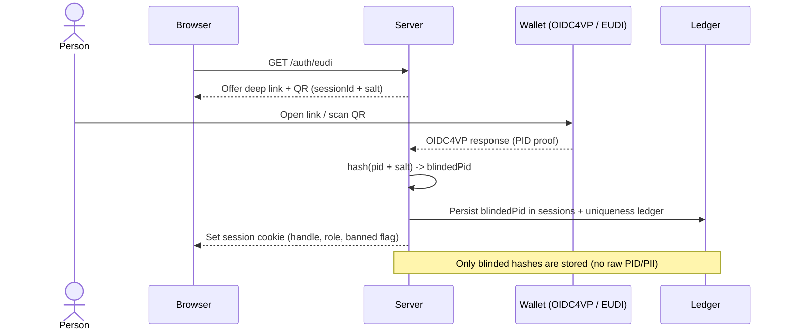

> **Important:** this repo provides the *verification scaffold and policy hooks*. Compliance and production hardening depend on your deployment’s legal and security context — treat the identity layer as a component you audit and evolve.

---

## Federation, vote envelopes, and redundancy

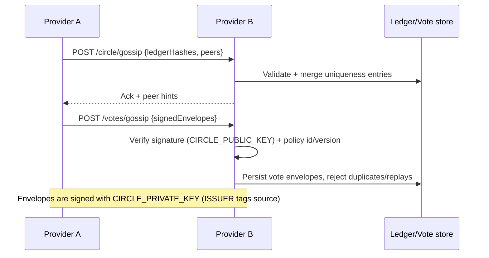

---

## Data modes, adapters, and preview/validation

The persistence layer is intentionally storage‑agnostic.

### Adapters
- `json` (default)
- `memory` (ephemeral)
- `sql` (SQLite)
- `kv` (single‑file KV JSON)
- `mysql` (MySQL, requires `mysql2`)
- `mongodb` (MongoDB, requires `mongodb`)

### Modes
- `DATA_MODE=centralized`: single provider store, no gossip writes/ingest
- `DATA_MODE=hybrid`: canonical store + gossip as redundancy/audit
- `DATA_MODE=p2p`: gossip‑ledger primary, optional local cache

### Preview & validation gates

Two switches gate uncertified data:

- `DATA_VALIDATION_LEVEL` (`strict|observe|off`)
- `DATA_PREVIEW` (`true|false`) to store and/or render preview entries

This allows deployments to experiment with helpers (topic gardeners, classification) and federation inputs *without silently treating them as authoritative*.

Ledger exports (`/circle/ledger`, `/votes/ledger`, `/transactions/ledger`) respect preview gating and omit preview entries when `DATA_PREVIEW=false`; they gzip-compress responses when `Accept-Encoding: gzip` is provided and the payload is at least ~2KB.

---

## Configuration

### Core knobs (env)

- Server: `HOST`, `PORT`
- Circle/policy: `ENFORCE_CIRCLE`, `CIRCLE_POLICY_ID`, `CIRCLE_NAME` (the name a fresh deployment starts with; `/admin` can rename it), `CIRCLE_ISSUER`, `GOSSIP_INTERVAL_SECONDS`, `GOSSIP_OPTIONAL_SKIP_SECONDS` (issuer labels gossip envelopes; `/admin` can override it in settings)
- Topic gardener: `TOPIC_GARDENER_SYNC_SECONDS` (poll `/operations` for rename/merge/split suggestions)
- Extensions: `CIRCLE_EXTENSIONS` (comma‑separated module names under `src/modules/extensions/`; initial migrations register these as installed and enabled)
- Signing: `CIRCLE_PRIVATE_KEY`, `CIRCLE_PUBLIC_KEY` (PEM). Use `npm run keys:circle` for PEM + .env‑ready output (optional libp2p ring ID included). Set `CIRCLE_RING_ID` to prefill the provider-blind ring ID in `/admin`. `/admin` can generate and persist keys into `settings.json`; env vars still override on restart.
- Outbound delivery: `OUTBOUND_EMAIL_WEBHOOK`, `OUTBOUND_SMS_WEBHOOK`, `OUTBOUND_WEBHOOK_HEADERS`, `OUTBOUND_TRANSPORT_MODULE`
- Ops metrics: `METRICS_SNAPSHOT_INTERVAL_SECONDS` (rolling bucket size), `METRICS_SNAPSHOT_RETENTION_HOURS` (retention window)
- Request body limits: `REQUEST_BODY_MAX_BYTES` (default 1MB), `REQUEST_BODY_REJECT_MULTIPART` (default true)
- Persistence:
  - `DATA_MODE` (`centralized|hybrid|p2p`)
  - `DATA_ADAPTER` (`json|memory|sql|kv|mysql|mongodb`)
  - `DATA_VALIDATION_LEVEL` (`strict|observe|off`)
  - `DATA_PREVIEW` (`true|false`)
  - SQL: `DATA_SQLITE_URL` / `DATA_SQLITE_FILE`
  - KV: `DATA_KV_FILE`
  - MySQL: `DATA_MYSQL_URL` (include the database in the URL) or `DATA_MYSQL_HOST` + `DATA_MYSQL_USER` + `DATA_MYSQL_DATABASE` (optional `DATA_MYSQL_PORT`, `DATA_MYSQL_PASSWORD`, `DATA_MYSQL_TABLE`)
  - MongoDB: `DATA_MONGO_URL` (include the database or set `DATA_MONGO_DB`, plus optional `DATA_MONGO_COLLECTION`)
- Rate limits: per‑action overrides via `/admin` (stored in `settings.rateLimits`)
- Social/media: `SOCIAL_MEDIA_MAX_BYTES` (default 10MB), `SOCIAL_MEDIA_REPORT_THRESHOLD` (default 3), `SOCIAL_MEDIA_FILENAME_MAX_BYTES` (default 256)

Provider settings are persisted in `src/data/settings.json` and can be edited via `/admin`.

### Common deployment recipes (settings + policy + extensions)

- **Local messaging sandbox (no verification)**  
  `DATA_MODE=centralized DATA_ADAPTER=memory ENFORCE_CIRCLE=false` — exercise UI flows without writing to disk.
- **Verified Circle, single provider**  
  `DATA_MODE=centralized DATA_ADAPTER=json ENFORCE_CIRCLE=true CIRCLE_POLICY_ID=party-circle CIRCLE_PUBLIC_KEY="$(cat /path/pub.pem)" CIRCLE_PRIVATE_KEY="$(cat /path/priv.pem)"` — strict gates + signed vote envelopes and ledger exports.
- **Hardened policy via extension**  
  Add `CIRCLE_EXTENSIONS=sample-policy-tighten` (or a custom module under `src/modules/extensions/`) to layer org‑specific checks without forking core code; `/admin` and `/extensions` expose discovered version metadata, non-destructive install/update/uninstall registration, and separate runtime enable/disable controls.
- **Hybrid redundancy (canonical + gossip)**  
  `DATA_MODE=hybrid DATA_ADAPTER=sql DATA_SQLITE_FILE=./data/party.db DATA_VALIDATION_LEVEL=observe GOSSIP_INTERVAL_SECONDS=30` — keep a SQL canonical store while ingesting gossip as preview data until validated.
- **P2P‑first ring**  
  `DATA_MODE=p2p DATA_ADAPTER=kv DATA_KV_FILE=./data/ring.json DATA_VALIDATION_LEVEL=strict DATA_PREVIEW=false CIRCLE_PUBLIC_KEY="$(cat /path/pub.pem)"` — gossip‑first sync and only accept signed/validated envelopes.
- **Topic/delegation experiments**  
  `DATA_PREVIEW=true DATA_VALIDATION_LEVEL=observe` — allow preview entries from topic gardeners or classification helpers; UI marks previews and replication filters them when disabled.

---

## Project map

### Entry / server
- `src/index.js`, `src/app/server.js`, `src/app/router.js`

### Interfaces (HTTP)
- Controllers: `src/modules/<module>/http/<module>.js` for UI modules, plus non-UI endpoints in `src/interfaces/http/controllers/`
- View helpers: `src/interfaces/http/views/`

### Domain modules
- `src/modules/` for identity/auth, circle policy, messaging/notifications, social feed/follows, topics/classification, petitions/signatures, votes/envelopes, delegation, groups/elections, federation (ActivityPub + gossip sync helpers), and extensions.

### Infra / persistence
- Adapters + migrations: `src/infra/persistence/`
- Replication helpers: `src/modules/federation/replication.js`
- Worker hooks reserved under: `src/infra/workers/`
- Shared utilities: `src/shared/utils/`

### Views / assets
- SSR templates: `src/modules/<module>/templates/` (core layout under `src/modules/core/templates/layout.html`, partials under `templates/partials/`)
- Styles/JS: `src/public/app.css`, `src/public/app.js`

### Extensions
- Registry: `src/modules/extensions/registry.js`
- Sample: `sample-policy-tighten.js` (versioned as `1.0.0`; bootstrap via `CIRCLE_EXTENSIONS` or install and enable from `/admin`)
- Lifecycle state: `settings.extensionInstallations` records provider-local source, installed version, and install/update timestamps; uninstall disables hooks and deregisters the extension without deleting its source file.

### Tests
- `npm test` runs the `node:test` suite in `tests/` (hashing, migrations, policy gates, classification, extensions, Puppeteer UI flows, ring gossip).
- `npm run test:ui` runs the UI‑only flow.

---

## Capabilities by module (endpoints + internals)

- **Auth & sessions:** `/auth/eudi` issues offers; `/auth/callback` finalizes through `src/modules/identity/*` (blinded PID hash + ActivityPub actor) and `src/modules/auth/http/auth.js`. Pending sessions can be resumed with `?session={id}`.
- **Uniqueness Ledger + circle sync:** ledger/sessions/peers persisted in `src/data/`; `/circle/gossip` ingests peer hashes + capability hints, `/circle/ledger` exports, `/circle/peers` manages hints. Signing/verification lives in `src/modules/circle/federation.js`.
- **Policy gates:** role-aware checks (person/moderator/delegate + banned flag) in `src/modules/circle/policy.js`; surfaced in `/health` and UI. Extensions can decorate/override decisions.
- **Coordination** uses `src/modules/organization/cases.js` for the case envelope. Cases link to their source discussion by id and retain its evidence by reference. Case actions appear in the provider admin transaction view.
- **Discussion and Forum** render server-side and share the discussion store. Search Forum articles by title, text, or category. Each result opens `/forum?thread=<id>` with chronological replies and evidence. Forum authors can choose a category or leave it to topic classification.
- **Social feed & follows:** `/social/*` handles short posts + replies + reshares driven by typed follows (circle/interest/info/alerts), plus optional photo/video uploads. Media stays provider-local, locks by default until viewers request access (view requests notify authors), and can be blocked after mass reports or manual review. Follow edges and micro-posts persist through `src/infra/persistence/storage.js`; the feed filter surfaces per-type counts so users can see coverage at a glance, and UX keeps this lane scoped to small talk/info so petitions/votes remain distinct.
- **Petitions + votes:** `/petitions` browses proposal summaries by stage and links to the Overview, Discussion, History, and Ballot workspace. Draft and revision forms support a structured outline, full text, and evidence. Quorum advances a draft to discussion or directly to voting with a frozen snapshot when configured. Moderators can confirm a freeze before opening a vote. Discussion supports stances, linked claims, evidence, and fact-check requests. Ballot links to the frozen revision and separates personal ballot status from the tally. Proposal forms return to the relevant record view. `/votes/ledger` exports votes and `/votes/gossip` ingests envelopes.
- **Notifications:** `/notifications` pages through unread and read alerts with Mark all read and local preferences. Proposal alerts link to the permitted scoped view. An alert whose proposal becomes inaccessible keeps its event type and time and omits the proposal details. `/notifications/read` marks alerts read, and `/notifications/preferences` saves proposal comment preferences.
- **Delegation & groups:** `src/modules/delegation/delegation.js` stores per-topic delegates with auto-resolution, matching a topic against its full path so a parent-category delegation covers its subcategories; `src/modules/delegation/delegatedBallots.js` resolves delegated ballots through the delegate's own vote and enforces the delegate vote window. `/delegation` manages manual preferences, lists ballots delegated to you (with deadline countdowns) and ballots you handed to a delegate (with an override link), and `/delegation/conflict` prompts when cachets clash. `src/modules/groups/*` publishes delegate preferences and runs elections with optional second/third-choice ballots and multi-round transfers, nests groups into branches, declares group categories for the `/groups` category directory, gates optional internal discussion/proposal lanes, and moves items up a level via `/petitions/promote` and `/discussion` (`intent=promote`); group policy (priority vs vote, conflict rules) is stored independently, vote-mode recommendations prefer the latest closed election winner, and the delegation UI surfaces election-winner metadata.
- **Groups UI**: closed elections surface the winner, method, and round count directly in the group panel, and closing an election auto-updates the delegate cachet for that topic.
- Group proposal writes check the proposal's current lane. Group membership enables editing, signing, commenting, voting, and receiving delegated ballots, subject to Circle policy. Stage changes and promotions retain their moderation checks. Successful group actions return to the resulting lane.
- **Topics & classification:** `src/modules/topics/classification.js` routes to extensions and the topic gardener helper (see `principle-docs/DynamicTopicCategorization.md`) to keep categories coherent, merge/split, and avoid conflicting provider labels. A topic registry persists ids/path metadata so SSR views can render breadcrumbs. Configure anchors/pins + optional helper URL via `/admin`; the helper runs from `src/infra/workers/topic-gardener/server.py` with scheduled refactor operations, and `/admin` surfaces pending rename/merge/split suggestions plus topic history diffs for review.
- **Admin & settings:** `/admin` toggles Circle policy, verification requirement, issuer (public URL for gossip envelopes), peers, extensions, and optional modules grouped by lane (`Organization operations`, `P2P social/community`, `Civic governance`, `Federation/resilience`), plus default group policy, topic gardener, gossip sync controls, media moderation (reports + view requests), persisted upload cleanup status, outbound delivery summaries, runtime ops metrics (module-disabled + rate-limit counters) plus retention/interval settings, and session overrides without editing JSON. Topic gardener review includes preview panels with confirmation for merge/split, pending rename/merge/split suggestions, a topic history diff view, and a manual sync button. Gossip push/pull controls disable when federation is off or data mode is centralized. Signing key status + keygen hints surface here; admin can generate signing keys into `settings.json` (env overrides on restart); provider-blind ring keys accept PEM blocks separated by blank lines (or one-line PEM with `\n` escapes).
- **ActivityPub stubs:** `/ap/actors/{hash}` exposes actor descriptors and `/ap/actors/{hash}/outbox` serves per-actor posts via `src/modules/federation/activitypub.js`; `/ap/outbox` serves a global collection; `/ap/objects/{id}` serves local note objects; `/ap/inbox` ingests preview social notes (ignores direct payloads not addressed to a local actor) and triggers mention/direct notifications. ActivityPub endpoints require federation + social modules to be enabled.
- **Transactions registry:** `/transactions` lists local, stamped entries for sensitive actions (petition drafts/status changes, votes, delegation overrides); `/transactions/export` emits a signed digest envelope, `/transactions/ledger` serves the envelope to peers, and `/transactions/gossip` ingests summaries for cross-provider reconciliation.

## UI & templating (extension‑aware)

- SSR‑first shell lives in `src/modules/<module>/templates/` with `src/modules/core/templates/layout.html` wrapping page templates; status strip surfaces Circle enforcement + validation/preview state so users see why content is gated. Styles/JS in `src/public/app.css` and `src/public/app.js`.
- The Citizen OS-inspired shell has grouped desktop navigation, a keyboard jump search, and a native Menu on narrow screens. A skip link reaches the main landmark. Home links directly to Forum articles, and Discussion keeps its scope, topic filter, and eligible compose link close to the feed. Forum preserves search and paging when you open an article, reply, and return to the collection. The dark, light, and system themes share the same panel and action styles. [UI roadmap](UI_ROADMAP.md)
- Navigation and panels follow module and role gates. Module toggles live in `/admin`, and extension toggles (`/extensions` or `CIRCLE_EXTENSIONS`) drive policy badges and gate messages.
- Verbosity controls: admin sets the default UI verbosity (full vs compact), verified users can override per session under `/profile` or from the top‑bar toggle, and admins can set per‑page presets via the Composer tool.
- Composer mode: admin-only floating tool for inline text/style edits, DOM order tweaks for composer-keyed elements, nav ordering, per-page layout (drag panels between columns, hide panels), and per-page verbosity presets.
- Composer overrides persist per template in `settings.composer.pages[pageKey]` (text/style/dom order), while layout + nav overrides remain global in `settings.composer`.
- Preview/provenance cues are consistent across modules (pills for `Preview` and `from {issuer}`); when `DATA_PREVIEW=false`, the server hides previews, otherwise label them. Social feed shows follow‑type filters + inline replies; discussion/forum reuse the same pill language.
- Templating personalization: duplicate templates under `src/modules/<module>/templates/` (and `templates/partials/`) to theme per deployment (colors/fonts can be tweaked in `app.css`); keep SSR placeholders (`{{...}}`) intact for router partial responses. Avoid SPA‑only components to preserve partial‑render navigation.
- Template partials: `{{> name}}` resolves `templates/partials/name.html` within the module; use `{{> module:name}}` for cross-module includes when needed.
- Extension UI hooks: use light‑touch badges or info strips to signal tightened policies (extension‑driven gate changes) instead of new flows; policy messages come from `circle/policy` so custom extensions display automatically. Notifications and social mentions reuse the same renderer to keep UX coherent across modules.

---

## Data management profiles, signing, and redundancy

### Storage layout (default JSON adapter)

Defaults live under `src/data/`:

- `ledger.json`, `sessions.json`, `peers.json`
- `discussions.json`, `petitions.json`, `signatures.json`, `votes.json`, `delegations.json`, `notifications.json`
- `organization-cases.json` after the first case is opened
- `topics.json`, `groups.json`, `group-policies.json`, `group-elections.json`
- `actors.json`
- `social-follows.json`, `social-posts.json`, `social-media.json`
- `transactions.json`, `transaction-summaries.json`
- `settings.json`, `meta.json`

Media binaries live under `src/data/media/` and are served through provider‑gated endpoints.

Adapter notes:
- `adapters/memory.js` is ephemeral.
- `adapters/sql.js` uses SQLite (`DATA_SQLITE_URL|FILE`, needs `sqlite3`).
- `adapters/kv.js` stores everything in a single KV JSON file.
- `adapters/mysql.js` uses MySQL (`mysql2` optional dep) with a single `state_entries` table.
- `adapters/mongodb.js` uses MongoDB (`mongodb` optional dep) with a single `state_entries` collection.
- `src/infra/persistence/storage.js` routes through `src/infra/persistence/store.js` to pick the adapter.

### Data management priorities

- Provider‑local contact fields stay local (no gossip).
- Previews are gated by `DATA_PREVIEW`; when disabled, preview payloads are rejected even in `observe/off` validation modes. Validation level only decides whether allowed previews stay marked as preview or arrive as validated.
- Redundancy is chosen via `DATA_MODE` (centralized/hybrid/p2p) and adapter.
- Signatures/validation state decide what can be rendered or replicated.

### Transactions (audit)

- **Main transactions registry**: append‑only log (type, petitionId, actorHash, digest) stored locally in `transactions.json` (or adapter equivalent) for sensitive operations (e.g., petition drafts, votes). Entries are stamped with issuer/mode/adapter and validation status; `/transactions` exposes recent entries for audit, `/health` surfaces counts/digests plus summary gossip totals.
- **Transactions summary gossip**: `/transactions/export` emits a summary envelope (issuer/mode/adapter, digests) signed when `CIRCLE_PRIVATE_KEY` is set; `/transactions/ledger` serves the envelope to peers and `/transactions/gossip` ingests summary envelopes into `transaction-summaries.json` for reconciliation. Use gossip carefully with strict validation.

### Profiles

- **Centralized profile**: `DATA_MODE=centralized` with any adapter; gossip is off (no ingest), all writes go to the chosen store. Best for single‑provider deployments and local dev. Back up `src/data/` (or the DB/KV file) regularly.
- **Hybrid profile**: `DATA_MODE=hybrid` keeps a canonical adapter (JSON/SQL/KV/MySQL/MongoDB) while accepting gossip for redundancy/audit. Pair with `DATA_VALIDATION_LEVEL=observe|strict` to decide if gossip is stored as preview or rejected; `DATA_PREVIEW=true` allows staging until validated. Control push/pull frequency with `GOSSIP_INTERVAL_SECONDS`.
- **P2P profile**: `DATA_MODE=p2p` treats gossip as primary, with an optional local cache. Combine with `DATA_PREVIEW=false` and `DATA_VALIDATION_LEVEL=strict` to only accept signed, validated envelopes. Peers listed in `/circle/peers` seed synchronization (including cached capability hints); replication logic lives in `src/modules/federation/replication.js`.

### Signing & provenance

- Votes and ledger exports can be signed with `CIRCLE_PRIVATE_KEY` (PEM) and verified with `CIRCLE_PUBLIC_KEY`.
- Exports include policy id/version (`CIRCLE_POLICY_ID`, defaults in settings).
- Admin UI surfaces validation state; UI labels preview vs validated content when `DATA_PREVIEW` is enabled.

### Redundancy practice

- Snapshot data before migrations or adapter switches.
- Publish `CIRCLE_PUBLIC_KEY` to peers before enabling signatures.
- Treat peers as hints, not trust anchors.
- Worker‑based topic gardeners live under `src/infra/workers/` and return preview entries gated by validation settings.

### Migrations

- `src/infra/persistence/migrations.js` normalizes schema versions (handles/roles, petition lifecycle, delegation/notifications, versioned extension installations, group elections, data topology, validationStatus on content/groups/delegations/notifications).
- Metadata lives in `meta.json`; running `npm start` or `npm test` applies upgrades.

---

## Development and testing

```bash
npm install
npm test         # node:test: hashing, migrations, classification hooks, policy gates, extensions, UI + ring tests
npm run test:ui  # Puppeteer UI-only flow
npm start        # starts the SSR server
npm run db:check # prints adapter/profile + record counts for the current DATA_ADAPTER
```

- The app is SSR‑first with a vanilla router interceptor: set `X-Requested-With: partial` to fetch partial HTML for app‑like navigation.
- Static assets live in `src/public`; keep new templates under `src/modules/<module>/templates/`.
- For UI work, initialize the optional Citizen OS design reference with `git submodule update --init -- thirds/citizenos-fe`. The roadmap maps its templates and styles to our server-rendered shell, collections, and focused workspaces. [UI roadmap](UI_ROADMAP.md)

---

## Operational notes (privacy, safety, backups)

- **No raw PID/PII**: persist only blinded hashes. Treat any provider‑local optional fields (email, personal details) as *local only* and never gossip them.
- **Peers are hints, not trust anchors**: federation tooling should assume peers can be wrong or malicious; strict validation and quarantine are part of the intended hardening path.
- **Audit visibility**: `/admin` surfaces ledger hash, gossip ingest state, outbound/inbound gossip sync status + durations, peer health reset actions, peer capability hints, pull/push skip-cache summaries, recent transactions, outbound delivery summaries, persisted upload cleanup stats, and runtime ops counters; `/transactions`, `/transactions/export`, `/transactions/ledger`, and `/transactions/gossip` provide JSON and signed summaries for reconciliation. `/health` exposes peer health summaries plus vote/transactions gossip added/updated counts, gossip durations, pull/push skip-cache counts, outbound delivery stats, persisted upload cleanup stats, and ops metrics for dashboards, including last peer ledger hash snapshots (match/mismatch). Gossip sync skips peers that disable modules or gossip, so peer health reflects real failures.
- **Gossip resilience**: optional endpoints (votes/transactions) that are missing or disabled are treated as skipped for peer health scoring, and outbound skip-cache avoids repeated retries to peers that currently disable gossip endpoints.
- **Backups**: if you run with JSON/KV storage, schedule backups of `src/data/` (or your DB/KV file), especially before migrations.
- **Ops metrics persistence**: module-disabled + rate-limit counters are snapshotted into `settings.json` on a rolling window (`METRICS_SNAPSHOT_INTERVAL_SECONDS`, `METRICS_SNAPSHOT_RETENTION_HOURS`) so restarts keep recent trends.

---
- Identity safety: only store blinded PID hashes; never persist wallet-provided PII. Keys used for envelope signing must be rotated carefully; publish `CIRCLE_PUBLIC_KEY` to peers before enabling signatures.
- Gossip: peers are hints, not trust anchors. Use Circle policy flags + `/health` to monitor enforcement and quarantine toxic providers.
- Data durability: JSON stores are append-heavy; schedule backups of `src/data/` and watch `meta.json` when migrations bump schema versions.
- Topic gardener: Python/ML helpers are expected to live under `src/infra/workers/` (see `principle-docs/DynamicTopicCategorization.md`); Node callers should reconcile provider outputs to avoid conflicting labels.

## Further reading

- `ROADMAP.md` — phased delivery plan and sequencing rationale
- `AGENTS.md` — implementation directives and vocabulary contract
- `principle-docs/RepresentativeParties.md` — design principles and thesis
- `principle-docs/OrganizationPressureManagement.md` — organization-pressure model
- `principle-docs/SimulationScenarios.md` — the two reference scenarios (a fictional Italian party; a fictional ASL) used to seed deployments, write tests, and take screenshots
- `principle-docs/DynamicTopicCategorization.md` — topic gardener spec

---

## Contributing

If you want to contribute, start by reading `AGENTS.md` and keep changes aligned with the vocabulary and privacy constraints. Small, testable modules are preferred over deep rewrites.
